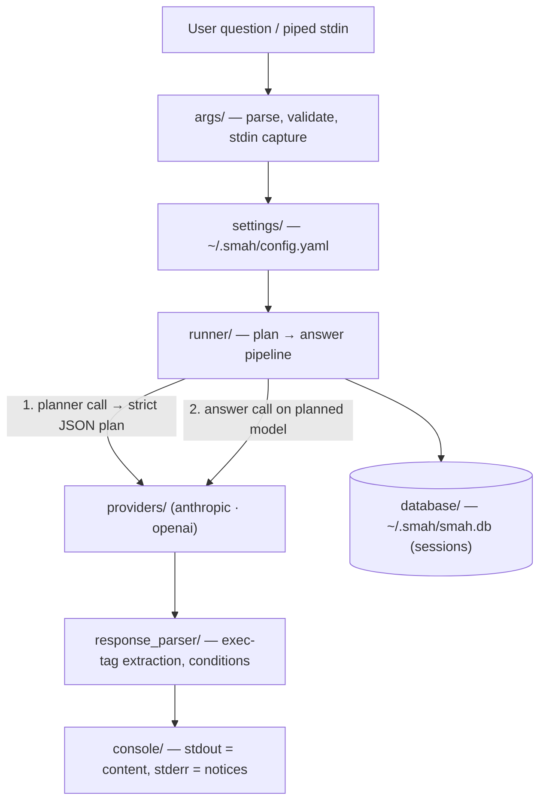

# Project Architecture — smah

## Overview

SMAH is a **print-only sysadmin CLI**: it turns plain-language questions into
explained shell commands and summarizes piped log input — it never executes
anything. A two-stage LLM pipeline (a cheap "planner" call, then an answer
call on the planned model) does the work, behind a vendor-neutral provider
seam (Anthropic first-tried default, OpenAI supported).

SMAH is deliberately **local-only**: no daemon, no server, no central
database. Everything it needs lives under `~/.smah/` — one YAML config, one
SQLite session store, rotating log files. First run is guided by
`smah config` (TTY wizard); unconfigured runs exit `3` with guidance rather
than crash.

→ *Components ↔ directories: see [PROJ-LAYOUT.md](PROJ-LAYOUT.md)*
→ *Command surface (normative UX contract): [ux/interface-spec.md](ux/interface-spec.md)*

## System Diagram

## Request Lifecycle

Startup wires logging, parses args (piped stdin is read **only** for `ask` /
the bare legacy path — doctor/models/history/config never touch stdin, so an
open non-tty stdin in CI can't hang them), then dispatches subcommands first
and legacy flags second. A query runs the plan→answer pipeline; sessions
persist transactionally and `smah resume` replays them into an interactive
REPL. All errors funnel to the shared exit-code table.

→ *See [arch/data-flow.md](arch/data-flow.md) for the stage-by-stage lifecycle*

## Core Components

| Component | Purpose |
|-----------|---------|
| CLI entry (`smah.py`) | Subcommand dispatch, legacy-flag shim, error funnel |
| `args/` | Parse/validate/normalize; stdin (pipe) capture rules |
| `runner/` | Two-stage plan-then-answer pipeline; task-model resolution |
| `providers/` | Vendor-neutral seam: base contract, registry, anthropic + openai |
| `response_parser.py` | lxml `<exec>`-tag extraction; whitelisted-AST `exec-if` conditions |
| `settings/` | Single-file config (`User`/`System`/`Inference`); TTY wizard; OS/user profiling |
| `database/` | SQLite session store; hand-rolled checksummed migrations (`smah-db`) |
| `commands/` | `config`, `doctor`, `models`, `history` subcommands |
| `logs/` | Rotating DEBUG file log + WARN-to-stderr console stream |
| `exit_codes.py` | Single source of truth for the exit-code table |

## Model Selection & Providers

There is no hardcoded default provider — selection is **model-driven** via
`inference.model_picker` (per-task lists: `query`/`pipe`/`picker`/`default`).
The code default tries `anthropic.claude-haiku-5-5` first, so Claude is the
working default; candidates are probed for credentials and skipped tolerantly.
Models are config-defined (provider, id, context in/out, use cases), never a
built-in catalog. Vendor quirks (system-param placement, `max_tokens`,
sentinel types, JSON mode emulation) are contained inside each provider;
provider errors translate to the shared exit-code table.

**Secrets discipline:** API keys resolve CLI flag → config (`$ENV_VAR`
indirection supported) → env (`SMAH_<KEY>_API_KEY` / `<KEY>_API_KEY`), are
never printed, never stored in the DB; `doctor` reports presence only;
`smah config show` redacts secret-looking keys.

## Safety Model — Print-Only Invariant

SMAH never executes commands. Model output containing `<exec shell title
purpose><command>` tags is rendered as review panels titled
"SUGGESTED COMMAND — NOT EXECUTED BY SMAH" with an explicit notice. Optional
`exec-if` conditions evaluate through a whitelisted AST walker (no
`eval()`/`exec()`; unevaluable ⇒ command skipped). Clipboard copy is
best-effort via optional `pyperclip` (not a dependency). The invariant is
enforced by `tests/test_no_shell_execution.py` — keep it green.

## Output Contract (stdout/stderr)

`stdout` carries **content only** (answers, raw pipe output, `--json`).
Every notice, deprecation warning, panel chrome, doctor report, and the
config wizard go to **stderr** — so `smah ask … | other-tool` stays clean.
`docs/ux/interface-spec.md` § 5 is normative and referenced from code
docstrings.

## Data & Storage

Everything under `~/.smah/` (override via `--config` / `--database`):

| Path | Contents |
|------|----------|
| `~/.smah/config.yaml` | Single config file: `User`, `System`, `Inference` sections (version-gated) |
| `~/.smah/smah.db` | SQLite: sessions only — `chat_history`, `chat_history_details`, `chat_history_message`, `settings` (last-session pointer). No secrets |
| `~/.smah/logs/` | Rotating DEBUG log (1 MB × 3) |

`smah`/`smah ask` auto-apply pending migrations at startup (silent; failure →
exit 1); `smah-db` is the manual migration CLI (up / rollback / status /
scaffold). Migration tracking is checksummed (`schema_migrations`).

## Exit Codes

| Code | Meaning |
|------|---------|
| 0 | Success |
| 1 | Unexpected internal error |
| 2 | Usage error (bad args; query required with no stdin) |
| 3 | Configuration error (missing/corrupt config; unknown provider) |
| 4 | Auth / no usable model (no API key, zero enabled models) |
| 5 | Provider or API error (4xx/5xx, network, unparseable plan) |

## Known Gaps & Stale Spots

- `docs/source/architecture.md` is a **stale aspirational draft** (predates
  the print-only rewrite): describes command execution, RBAC/guardrails,
  Postgres+TimescaleDB, multi-tenant DBs — none exist. Superseded by this
  file; kept as history until rewritten.
- **Bug:** `commands/doctor.py` `__check_provider` still treats OpenAI as the
  only runnable provider and fails on any enabled non-openai provider —
  contradicts the shipped Anthropic provider.
- `smah chat` is an honest stub (notice + exit 2), never faked.
- `prompts.py` `run_command_tool` is dead code (tools are never sent).
- `.gitignore` entries `config/`, `noizu_*egg-info`, `noizu-ops.log` are
  leftovers from the repo's previous life (noizu-ops/noizu-help) — no code
  references them.

## Key Decisions

- **Print-only by design** — the product's core promise; test-enforced.
- **Two-stage model-driven routing** — the planner call *is* the router:
  picks the answering model, decides settings injection and output format.
- **Vendor-neutral provider seam** — runner never branches on vendor identity.
- **Local-only persistence** — SQLite sessions, no server, no telemetry path.
- **stdout purity** — content-only stdout makes SMAH composable in pipes.
- **Legacy-flag back-compat shim** — one-line stderr notices, removal targeted 0.4.

## Technology Stack

Python ≥3.10 (CI matrix 3.10/3.12/3.13) · Poetry · `rich` (console) ·
`anthropic` + `openai` SDKs · `pyyaml` · `psutil` (system profiling) ·
`lxml` + `cssselect` (response parsing) · pytest · Sphinx/ReadTheDocs
(`smah.readthedocs.io`) · GitHub Actions (pytest CI, PyPI Trusted Publishing
on `v*` tags).
