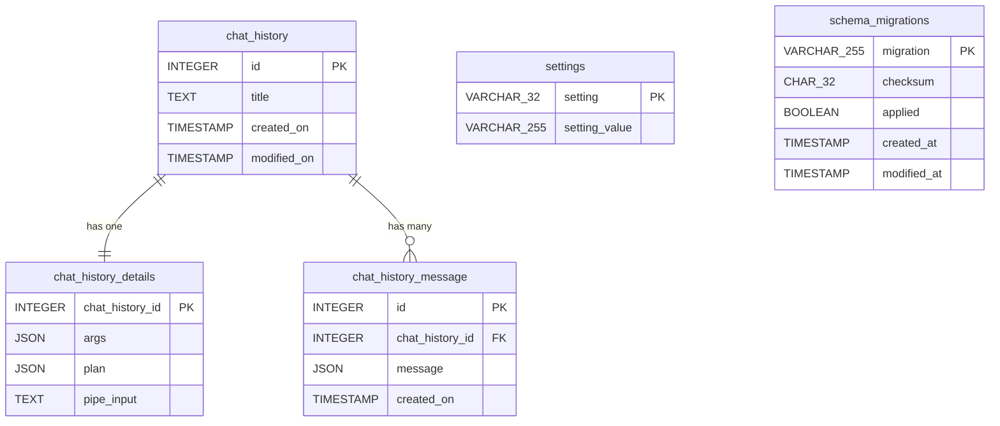
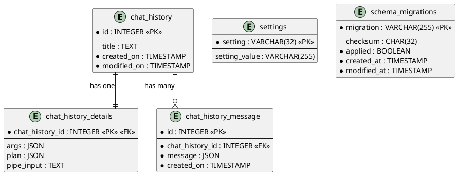

# Project Schema — smah

Data-schema reference for SMAH: the persistence layer plus every other
structured-data surface in the repo. SMAH is **local-only** — the single
relational store is a **SQLite** session database at `~/.smah/smah.db`
(override with `--database`), managed by a hand-rolled, checksummed Python
migration runner. There is no Liquibase, no server database, no KV layer.
Directory map: [PROJ-LAYOUT.md](PROJ-LAYOUT.md) · architecture:
[PROJ-ARCH.md](PROJ-ARCH.md).

## Persistence (SQLite)

Four tables come from the single shipped migration
(`smah/database/migrations/1730153754_history.py`); the fifth,
`schema_migrations`, is created by the migration runner itself
(`smah/database/migration.py`) to track checksums.

### ERD

### chat_history — one row per session

| Column | Type | Nullable | Default | Description |
|--------|------|----------|---------|-------------|
| id | INTEGER | No | AUTOINCREMENT | Primary key; session id used by `resume` |
| title | TEXT | Yes | NULL | Planner-derived session title |
| created_on | TIMESTAMP | No | CURRENT_TIMESTAMP | Creation time |
| modified_on | TIMESTAMP | No | CURRENT_TIMESTAMP | Last modification time |

### chat_history_details — 1:1 run payload

| Column | Type | Nullable | Default | Description |
|--------|------|----------|---------|-------------|
| chat_history_id | INTEGER | No | — | PK **and** FK → `chat_history.id` |
| args | JSON | Yes | NULL | Full argparse namespace dump of the run |
| plan | JSON | Yes | NULL | Planner's strict-JSON plan |
| pipe_input | TEXT | Yes | NULL | Full piped stdin, untruncated |

### chat_history_message — message thread

| Column | Type | Nullable | Default | Description |
|--------|------|----------|---------|-------------|
| id | INTEGER | No | AUTOINCREMENT | Primary key; ordering key for replay |
| chat_history_id | INTEGER | No | — | FK → `chat_history.id` |
| message | JSON | No | — | One message of the thread (role+content JSON) |
| created_on | TIMESTAMP | No | CURRENT_TIMESTAMP | Write time |

### settings — key/value runtime pointers

| Column | Type | Nullable | Default | Description |
|--------|------|----------|---------|-------------|
| setting | VARCHAR(32) | No | — | Primary key; known key: `last_session` |
| setting_value | VARCHAR(255) | Yes | NULL | e.g. a `chat_history.id` (soft pointer, parsed app-side) |

### schema_migrations — migration bookkeeping

| Column | Type | Nullable | Default | Description |
|--------|------|----------|---------|-------------|
| migration | VARCHAR(255) | No | — | PK; migration filename (e.g. `1730153754_history.py`) |
| checksum | CHAR(32) | Yes | NULL | MD5 of the migration file at apply time |
| applied | BOOLEAN | No | FALSE | `up` applied and not since rolled back |
| created_at | TIMESTAMP | No | CURRENT_TIMESTAMP | Row creation |
| modified_at | TIMESTAMP | No | CURRENT_TIMESTAMP | Last apply/rollback |

**Indexes**: none declared — primary keys only (SQLite implicit auto-indexes;
`chat_history_details.chat_history_id` is the primary key, so the FK lookup is
the PK index).
**Constraints**: FKs are declared in DDL, but `sqlite3.connect()` leaves
`PRAGMA foreign_keys` OFF (never set in `database.py`), so enforcement is
application-side. `save_chat()` writes history + details + messages in one
`BEGIN TRANSACTION` (`database.py`).
**Timestamps**: this schema predates the house `updated_at` convention — it
uses `created_on`/`modified_on` (and `created_at`/`modified_at` on
`schema_migrations`). Documented as-is; renaming columns in existing user DBs
would be churn without payoff. UTC via SQLite `CURRENT_TIMESTAMP`.

### Migration history

| Migration | Creates | Notes |
|-----------|---------|-------|
| `1730153754_history.py` | `chat_history`, `chat_history_details`, `chat_history_message`, `settings` | `down()` drops all four |

Runner behavior: `smah ask`/`resume` auto-apply pending migrations silently at
startup (failure → exit 1); `smah-db` is the manual CLI (up / rollback /
status). Checksums are MD5 (`hashlib.md5`) — Rust port keeps MD5 for byte
parity (`md-5` in `crates/`). Migrations load only from the shipped package
directory, never `~/.smah/`.

## Non-relational structured data

### Config file — `~/.smah/config.yaml` (override `--config`)

Single YAML file, `yaml.safe_load`, version-gated (`vsn <= "0.0.1"` per
section). Shape (see README § Fine Tuning for a full example):

| Section | Keys | Purpose |
|---------|------|---------|
| `vsn` | — | Schema version gate |
| `user` | `name`, `role`, `system_admin_experience`, `about` | Operator profile injected into prompts |
| `system` | `operating_system{type,name,version,release,info{kind,source,details}}`, stats | psutil-derived host facts |
| `inference.instructions` | text or null | Optional per-request instruction |
| `inference.model_picker` | `query`/`pipe`/`picker`/`default` lists | Per-task model candidate lists (planner is the router) |
| `inference.providers.<name>` | `settings{api_key or $ENV_VAR}`, `models[]` | Provider credentials + model catalog |

Model entries carry `name`, `model`, `enabled`, `context{window,out}`,
`modalities`, `strengths`/`weaknesses`, `attributes` (speed/reasoning/…),
`cost{million_tokens_in,out}`, `use_cases[]`. Secrets: `api_key` may be a
literal or `$ENV_VAR` indirection; `smah config show` masks both
(`<env:NAME>`); keys are never written to the DB (see THREAT-MODEL T-001 for
the logging exception).

### Data interfaces (in motion)

| Interface | Shape | Failure mode |
|-----------|-------|--------------|
| Planner response | Strict JSON `{title, model, reason, include_settings, format_output, instructions}` | Invalid JSON ⇒ exit 5 |
| Provider calls | Vendor SDKs (Python) via `providers/{base,anthropic_provider,openai_provider}.py`; streaming where supported | Vendor errors → exit 4 (auth) / 5 (provider) |
| Model output | Text with optional `<exec shell title purpose>` tags + `exec-if` conditions | Parsed by lxml `ResponseParser`; rendered as NOT-EXECUTED panels |

### Structured files in the repo

| Path | Format | Purpose |
|------|--------|---------|
| `project-management/epics/index.yaml`, `personas/index.yaml`, `user-stories/index.yaml` | YAML | Id/slug/status indexes over the PM markdown registers |
| `smah/settings/inference/inference_defaults.yaml` | YAML | Default model catalog seeded into first-run config |
| `docs/source/code/_autosummary/*.rst` | reST | GENERATED by Sphinx autosummary — not hand-maintained data |

### Absent (checked, clean)

No Redis/KV layer, no test fixtures directory, no seed corpora; `~/.smah/logs/`
is rotating free-text (1 MB × 3) inventoried in
[THREAT-MODEL](THREAT-MODEL.md) / `threats/data-stores.md`, not a schema.
