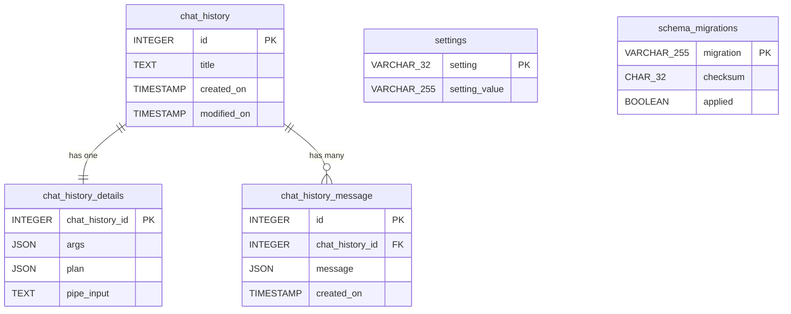

# Project Schema — summary

Condensed reference extracted from [PROJ-SCHEMA.md](PROJ-SCHEMA.md); kept in sync.

**Store**: local SQLite only — `~/.smah/smah.db` (override `--database`).
No server DB, no Liquibase, no KV layer. Tables from single migration
`1730153754_history.py` + runner-created `schema_migrations` (MD5-checksummed,
transactional; auto-applied at `ask`/`resume` startup, `smah-db` manual CLI).

| Table | PK | Cols | Notes |
|-------|----|------|-------|
| `chat_history` | id (autoincrement) | 4 | one row per session |
| `chat_history_details` | chat_history_id (= FK) | 4 | 1:1 args/plan/pipe payload |
| `chat_history_message` | id (autoincrement) | 4 | ordered message thread (JSON) |
| `settings` | setting | 2 | KV; `last_session` soft pointer |
| `schema_migrations` | migration filename | 5 | MD5 checksum + applied flag |

Timestamps use `created_on`/`modified_on` (pre-dates house `updated_at`
convention — documented as-is). FKs declared but `PRAGMA foreign_keys` is off;
integrity is application-side (transactional `save_chat`).

**Non-relational**: `~/.smah/config.yaml` (`vsn`-gated `user`/`system`/
`inference`; `model_picker` lists; provider `api_key` literal or `$ENV_VAR`,
masked by `config show`, never in DB) · planner strict-JSON plan contract ·
`project-management/*/index.yaml` indexes · `inference_defaults.yaml` seed
catalog. No Redis, no fixtures, no seed corpora; logs are free-text (see
[THREAT-MODEL.md](THREAT-MODEL.md)).
