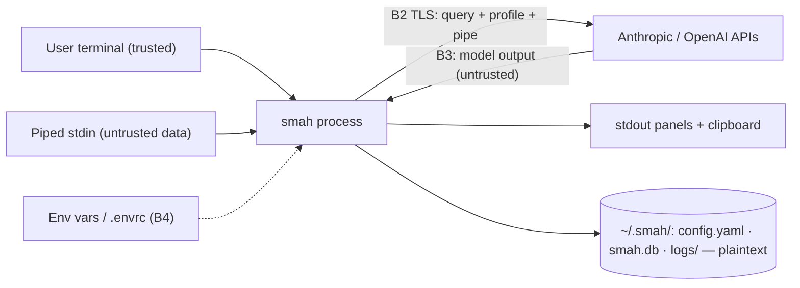

# Threat Model — smah

<!-- 〚📁:0976ac04-51ab-5663-9d6f-13d841036439〛 THREAT-MODEL :: Living STRIDE threat model — trust boundaries, vulnerability register, controls, residual risk. -->

## Overview

SMAH is a **local-only, print-only CLI**: no daemon, no server, no inbound
network surface. Its crown jewels are (1) provider **API keys** (spend
authority on Anthropic/OpenAI), (2) **session history + operator/system
profile** in `~/.smah/smah.db`, and (3) the **host itself** — which the
print-only invariant protects from model output. The only external boundary
is egress to LLM provider APIs; the only untrusted *data* inputs are piped
stdin and model responses.

⚠ `docs/source/architecture.md` (stale draft) claims RBAC and "SMAHRails"
guardrails — **neither exists**. Never cite them as mitigations; this file
is the authoritative control inventory.

**Trust boundaries:**
- **B1** host user / local attacker ↔ smah process and `~/.smah/` files
- **B2** smah ↔ LLM provider APIs (TLS via vendor SDKs; data egress)
- **B3** model output (untrusted) ↔ response parser, console, clipboard
- **B4** environment ↔ process (env vars incl. SDK base-URL overrides, direnv)
- **B5** CI/CD ↔ PyPI (release path)

## Attack Surface

No deployed perimeter exists (no Dockerfile/helm/ingress); distribution is
the PyPI package plus GitHub Actions release via Trusted Publishing.

→ *See [threats/attack-surface.md](threats/attack-surface.md) for the full STRIDE enumeration*

## Vulnerability Register

| ID | Severity | STRIDE | Component | Status |
|----|----------|--------|-----------|--------|
| T-001 | **High** | Info disclosure | Plaintext API key written to DEBUG log (`Settings.log()` save-mode dump, `settings.py:126`, every ask) | **Open** |
| T-002 | Medium | Info disclosure | Query, full pipe input, operator/system profile logged to `~/.smah/logs/` and stored plaintext in `smah.db`; no encryption or permission hardening anywhere | Open |
| T-003 | Medium | Elevation (social) | Suggested command auto-copied to clipboard, no prompt (`runner.py:146-152`) — injected command sits one paste from execution | Partial |
| T-004 | Medium | Tampering / Elevation | Prompt injection via piped input → model-suggested commands. Execution contained by print-only invariant (test + CI gate); residual = user pastes | Mitigated (execution) |
| T-005 | Low | Spoofing / Tampering | No `base_url` config in code (good) — but SDK-native `OPENAI_BASE_URL`/`ANTHROPIC_BASE_URL` env overrides redirect key + traffic if the environment is attacker-controlled | Accepted (env = B4 trust) |
| T-006 | Low | Tampering | lxml parsing of model output relies on library defaults (no explicit `resolve_entities=False`, `no_network`, `huge_tree` args); behavior is version-dependent | Partial |
| T-007 | Low | Tampering (supply chain) | Python workflows (`ci.yml`, `release.yml`) pinned by moving tags (`checkout@v4`, `setup-python@v5`, `pypi-publish@release/v1`), not commit SHA; the Rust `ci-rs.yml` is SHA-pinned | Open |
| T-008 | Info | Repudiation | All queries/pipes/system profile sent to third-party providers that log server-side — inherent to the product | Accepted |
| T-009 | Low | Denial of service / cost | Full pipe is sent to the answer call untruncated (planner truncates; answer does not) — large pipe = large token spend | Accepted |

**Coverage:** 1 mitigated · 2 partial · 3 open · 3 accepted. Open items have
no tracker tickets yet — file issues before fixing (T-001 first).

→ *Control details: [threats/data-stores.md](threats/data-stores.md) · [threats/supply-chain.md](threats/supply-chain.md)*

## Key Controls (verified in code)

- **Print-only invariant**: `tests/test_no_shell_execution.py` scans every
  `smah/**/*.py` for `subprocess.run`/`shell=True`/`os.system`/`Popen`
  (allowlist: 4 OS-info readers, fixed-argv `check_output`, never
  model-touched); CI re-enforces the same grep gate. No `eval`/`exec`/
  `pickle`/`os.exec*` anywhere; `exec-if` conditions use a whitelisted AST
  walker.
- **YAML**: `yaml.safe_load` at every load site; no unsafe `yaml.load`.
- **Secrets handling**: keys never printed, never stored in the DB; `config
  show` redacts; `$ENV_VAR` indirection masks as `<env:NAME>`; provider
  settings dumps pop `settings` outside save mode.
- **Endpoint pinning**: clients constructed with `api_key` only — config
  tampering cannot redirect traffic.
- **PyPI release**: Trusted Publishing (OIDC), no long-lived tokens;
  tag↔version match gate.

## Residual Risk

- **Local attacker / compromised host**: plaintext `config.yaml`, `smah.db`,
  and logs mean full key + history compromise. Accepted: a local attacker
  with the user's account can already read process memory; hardening (keyring,
  0600 perms, T-001 fix) raises cost but not the boundary.
- **User pastes a suggested command**: print-only cannot protect against the
  human in the loop (T-003/T-004 residual). Panels label commands
  "NOT EXECUTED BY SMAH"; clipboard auto-copy lowers user friction — the
  accepted trade-off for speed.
- **Provider-side data**: everything sent to Anthropic/OpenAI is outside
  SMAH's control (T-008); sensitive pipes should not be piped into smah
  until provider data-retention choices are explicit.

## Grounding

Components and data flow: [PROJ-ARCH.md](PROJ-ARCH.md) · directories:
[PROJ-LAYOUT.md](PROJ-LAYOUT.md) · normative UX contract:
[ux/interface-spec.md](ux/interface-spec.md).
